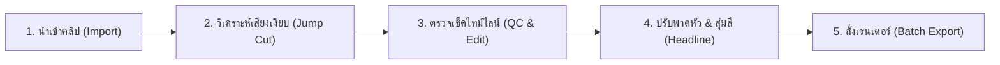

# ✂️ คู่มือการติดตั้งและใช้งาน BWCut Studio v1.0.1 (ฉบับสมบูรณ์)
**โดย fasterpsu (BW OS) — 100% Free & Open-Source AI Video Editor**

---

## 📌 บทนำ (About BWCut Studio)
**BWCut Studio** คือเวิร์กสเตชันตัดต่อคลิปวิดีโอสั้น (TikTok, Reels, Shorts) แบบอัตโนมัติความเร็วสูง ถูกพัฒนาขึ้นเพื่อแก้ปัญหาการนั่งตัดต่อคลิปทีละหลายสิบตัว โดยรวมพลังของ **Offline FFmpeg Engine** ที่เร็วระดับวินาที เข้ากับ **AI ถอดเสียงและคิดพาดหัว (Gemini & Groq)** ช่วยให้คุณตัด Jump Cut ตัดเดดแอร์ ใส่หัวเรื่อง ใส่ฟิลเตอร์ผิวเนียน และเรนเดอร์คลิปพร้อมโพสต์ได้แบบอัตโนมัติ 100%

---

## 🛠️ ขั้นตอนการติดตั้ง (ง่ายที่สุดใน 1 คลิก)

### ข้อกำหนดของระบบ (System Requirements)
- **ระบบปฏิบัติการ:** Windows 10 หรือ Windows 11 (64-bit)
- **RAM:** แนะนำ 8 GB ขึ้นไป
- **พื้นที่ว่างในดิสก์:** อย่างน้อย 5-10 GB สำหรับเก็บไฟล์วิดีโอเรนเดอร์
- **อินเทอร์เน็ต:** จำเป็นสำหรับการติดตั้งครั้งแรก (เพื่อโหลดโมดูลและอัปเดต)
- **การ์ดจอ (ถ้ามี):** รองรับ NVIDIA (NVENC), AMD Radeon (AMF), Intel (QSV) หรือใช้ CPU ก็ได้

---

### วิธีติดตั้งทีละสเต็ป:
1. **แตกไฟล์ Zip**:
   - คลิกขวาที่ไฟล์ `BWCut-Studio-Installer.zip` เลือก **Extract All... (แตกไฟล์ทั้งหมด)**
   - แนะนำให้แตกไฟล์ไว้ที่หน้าเดสก์ท็อป หรือไดรฟ์ที่มีพื้นที่ว่าง เช่น `D:\BWCut` หรือ `C:\BWCut`
2. **รันตัวติดตั้ง**:
   - ดับเบิลคลิกที่ไฟล์ **`Install-BWCut.bat`**
   - ตัวติดตั้งจะทำการตรวจสอบสเปกคอมพิวเตอร์ของคุณอัตโนมัติ (RAM, CPU, การ์ดจอ)
   - หากในเครื่องยังไม่มี **Node.js, Git หรือ FFmpeg** ตัวติดตั้งจะช่วยดาวน์โหลดและตั้งค่าให้โดยอัตโนมัติผ่าน Windows Package Manager (winget)
   - ตัวติดตั้งจะสร้างไอคอนทางลัด **"BWCut Studio"** ไว้ที่หน้าจอ Desktop ให้ทันที
3. **เปิดใช้งาน**:
   - เมื่อติดตั้งเสร็จ หน้าต่างเบราว์เซอร์จะเปิดเข้าสู่หน้าโปรแกรมที่ `http://127.0.0.1:3110` โดยอัตโนมัติ!
   - ในครั้งต่อไป สามารถดับเบิลคลิกที่ไอคอน **"BWCut Studio"** บนหน้าจอ Desktop เพื่อเปิดใช้งานได้ทันที

---

## 🔑 วิธีขอรับ API Key ฟรี (สำหรับระบบ AI พาดหัวและถอดเสียง)

โปรแกรมสามารถใช้งานตัดต่อเสียงเงียบและเรนเดอร์ได้ทันทีโดยไม่ต้องใช้ API Key แต่ถ้าต้องการให้ **AI คิดพาดหัวคลิปภาษาไทยสะดุดตา** และ **ถอดเสียงอัตโนมัติ** ให้ขอรับคีย์ฟรีได้ดังนี้:

### 1. Google Gemini API Key (สำหรับคิดพาดหัวคลิป 2 บรรทัดดึงดูดสายตา)
1. เข้าไปที่เว็บไซต์: [https://aistudio.google.com/apikey](https://aistudio.google.com/apikey)
2. เข้าสู่ระบบด้วยบัญชี Google
3. คลิกปุ่ม **"Create API Key"** แล้วคัดลอกรหัสคีย์ที่ได้มา

### 2. Groq API Key (สำหรับถอดเสียงพูดภาษาไทยเร็วระดับเสี้ยววินาที)
1. เข้าไปที่เว็บไซต์: [https://console.groq.com/keys](https://console.groq.com/keys)
2. สมัครหรือเข้าสู่ระบบด้วย Google Account
3. คลิกปุ่ม **"Create API Key"** ตั้งชื่อแล้วคัดลอกรหัสคีย์ (ขึ้นต้นด้วย `gsk_...`)

### นำคีย์มากรอกในโปรแกรม:
- ในหน้าจอโปรแกรม BWCut Studio คลิกที่เมนู **"⚙️ ตั้งค่า"** (มุมขวาบน)
- แท็บ **AI & API Keys** ให้นำคีย์ Gemini และ Groq ไปวางในช่อง
- กดปุ่ม **"บันทึกการตั้งค่า"**

---

## 🎬 คู่มือขั้นตอนการใช้งาน (Workflow)

### ขั้นตอนที่ 1: นำเข้าคลิปวิดีโอ (Import)
1. ที่หน้าแรก (คลังวิดีโอ) ลากไฟล์คลิปวิดีโอ (`.mp4`, `.mov`) มาปล่อยในช่อง หรือกดปุ่ม **"เลือกโฟลเดอร์คลิป"**
2. ระบบจะโหลดรายชื่อคลิป พร้อมแสดงพรีวิวภาพขนาดย่อ (Thumbnail)

### ขั้นตอนที่ 2: ระบบตรวจจับเสียงเงียบ (Automatic Jump Cut)
- ทันทีที่เลือกคลิป ระบบจะวิเคราะห์คลื่นเสียง (Waveform) และระบุช่วงที่เป็น "เดดแอร์" หรือ "ช่วงหยุดพูด" ให้เป็นแถบสีแดงโดยอัตโนมัติ
- วิดีโอจะถูกตัดช่วงเงียบทิ้ง ทำให้คลิปกระชับ น่าติดตาม ไม่มีช่วงน่าเบื่อ

### ขั้นตอนที่ 3: ตรวจสอบและแก้ไขบนไทม์ไลน์ (QC & Timeline Edit)
- **การมาร์กจุดตัดด้วยตนเอง:**
  - กดแป้น <kbd>Spacebar</kbd> เพื่อเล่น/หยุดวิดีโอ
  - กด <kbd>I</kbd> ที่จุดเริ่มต้นช่วงที่ไม่ต้องการ (Mark In)
  - กด <kbd>O</kbd> ที่จุดสิ้นสุดช่วงที่ไม่ต้องการ (Mark Out)
  - กด <kbd>X</kbd> หรือปุ่ม <kbd>Delete</kbd> เพื่อตัดช่วงนั้นทิ้งทันที
- **การกู้คืนเสียงพูด:**
  - หากระบบตัดเสียงตรงไหนเกินไป ให้เลื่อนหัวอ่านไปที่ช่วงแถบสีแดง แล้วกด <kbd>R</kbd> (Restore) เพื่อดึงเสียงพูดกลับคืนมา
- เมื่อตรวจคลิปพอใจแล้ว กดปุ่ม <kbd>Enter</kbd> หรือคลิก **"อนุมัติคลิป (QC ผ่าน)"** เพื่อข้ามไปคลิปถัดไป

### ขั้นตอนที่ 4: พาดหัวคลิปและสีสัน (Headline & Typography)
- **พาดหัว AI:** เมื่อกดปุ่ม **"สร้างพาดหัวด้วย AI"** ระบบจะอ่านเสียงพูดแล้วสร้างข้อความพาดหัว 2 บรรทัด (บน/ล่าง) ให้ทันที
- **ระบบสุ่มสีพาดหัว (Random Palette):**
  - มีชุดสีสะดุดตายอดนิยม 10 คู่สี (เช่น เหลือง-ขาว, ส้ม-ขาว, เขียวเลมอน-ขาว, ชมพูนีออน-ขาว)
  - หากเปิดตัวเลือก `สุ่มสีพาดหัว` ไว้ แต่ละคลิปที่เรนเดอร์จะได้คู่สีที่แตกต่างกัน ดูหลากหลายและเป็นมืออาชีพ
- **ฟอนต์ภาษาไทยฟรี 100%:** มีฟอนต์มาตรฐานคัดสรรมาให้ 10 ฟอนต์ เช่น **Prompt, Kanit, Mitr, Noto Sans Thai** แสดงผลคมชัด ไม่ติดปัญหาลิขสิทธิ์

### ขั้นตอนที่ 5: ฟังก์ชันเสริมระดับโปร
- **Hook Zoom (ซูมเปิดหัวคลิป):** ขยายซูมภาพช่วง 3 วินาทีแรก (140%) เพื่อดึงดูดสายตาคนดูทันทีที่เลื่อนฟีดมาเจอ
- **Beauty Filter (หน้าเนียนสว่าง):** มีให้เลือก 3 ระดับ (Natural, Smooth Plus, Glow) ช่วยปรับผิวหน้าคนพูดให้สว่างเนียนใสอย่างเป็นธรรมชาติ
- **ตัดท้ายคลิป (Trim Outro):** ตัดช่วงท้ายคลิปที่เอื้อมมือไปกดปิดกล้องทิ้งอัตโนมัติ (เช่น 0.5 - 1.0 วินาที)

### ขั้นตอนที่ 6: การส่งออกไฟล์ (Export & Batch Render)
1. ไปที่แท็บ **"ส่งออก & เรนเดอร์"**
2. เลือกคลิปที่ผ่านการ QC แล้ว (หรือเลือกทั้งหมด)
3. กดปุ่ม **"🚀 เริ่มเรนเดอร์ทั้งหมด"**
4. ระบบจะประมวลผลผ่าน GPU ด้วยฮาร์ดแวร์เร่งความเร็ว และเซฟไฟล์ไปที่โฟลเดอร์ `rendered/` พร้อมแจ้งเตือนเมื่อเสร็จสิ้น

---

## ⌨️ ตารางคีย์ลัดสำหรับทำงานไว (Hotkeys)

| ปุ่มคีย์ลัด | หน้าที่การทำงาน |
| :---: | :--- |
| <kbd>Spacebar</kbd> | เล่น / หยุดเล่นพรีวิววิดีโอ |
| <kbd>I</kbd> | กำหนดจุดเริ่มตัด (Mark In) |
| <kbd>O</kbd> | กำหนดจุดสิ้นสุดตัด (Mark Out) |
| <kbd>X</kbd> หรือ <kbd>Delete</kbd> | ตัดช่วงที่มาร์กทิ้งทันที |
| <kbd>R</kbd> | กู้คืนช่วงที่ถูกตัดกลับมา (Restore) |
| <kbd>Enter</kbd> | ผ่าน QC คลิปนี้ และเปิดคลิปถัดไปทันที |
| <kbd>[</kbd> / <kbd>]</kbd> | ย้อนกลับไปคลิปก่อนหน้า / ข้ามไปคลิปถัดไป |
| <kbd>Ctrl</kbd> + <kbd>Z</kbd> | เลิกทำ (Undo) |
| <kbd>Ctrl</kbd> + <kbd>Y</kbd> | ทำซ้ำ (Redo) |
| <kbd>Ctrl</kbd> + หมุนลูกกลิ้งเมาส์ | ซูมเข้า / ซูมออกไทม์ไลน์เสียง |

---

## ❓ คำถามที่พบบ่อย (FAQ & การแก้ไขปัญหา)

**Q: ดับเบิลคลิก `Install-BWCut.bat` แล้วหน้าต่างปิดไปทันที?**
- **A:** ให้ลองคลิกขวาที่ไฟล์ `Install-BWCut.bat` แล้วเลือก **Run as administrator (เรียกใช้ในฐานะผู้ดูแลระบบ)** หรือเปิดผ่าน Command Prompt

**Q: ฟอนต์ภาษาไทยในวิดีโอที่เรนเดอร์ออกมาเป็นสี่เหลี่ยมหรือตัวหนังสือเพี้ยน?**
- **A:** ฟอนต์ทั้งหมดถูกแพ็กมาในโฟลเดอร์ `fonts/` ของโปรแกรมเรียบร้อยแล้ว ไม่จำเป็นต้องติดตั้งลง Windows แต่ขอให้แน่ใจว่าไม่ได้ลบหรือย้ายโฟลเดอร์ `fonts/` ออกไปจากโฟลเดอร์โปรแกรม

**Q: ต้องการใช้งานผ่านแท็บเล็ต iPad หรือมือถือทำได้ไหม?**
- **A:** ทำได้ครับ! เพียงให้คอมพิวเตอร์และ iPad ต่อ Wi-Fi เดียวกัน จากนั้นดู IP Address ของคอมพิวเตอร์ (หรือดูจากหน้า Settings ของโปรแกรม) แล้วพิมพ์ URL เช่น `http://192.168.1.XX:3110` บน Safari/Chrome ใน iPad เพื่อตัดต่อได้เลย

**Q: ต้องการถอนการติดตั้งโปรแกรม (Uninstall) ทำอย่างไร?**
- **A:** ดับเบิลคลิกที่ไฟล์ `Uninstall-BWCut.bat` ในโฟลเดอร์โปรแกรม ระบบจะช่วยปิดโปรแกรม, ลบไอคอนทางลัดบน Desktop และล้างไฟล์แคชให้สะอาดหมดจด 100% ครับ

---

*พัฒนาและดูแลโดย fasterpsu (BW OS) — สนับสนุนการทำคลิปของครีเอเตอร์ไทยทุกคนครับ*

